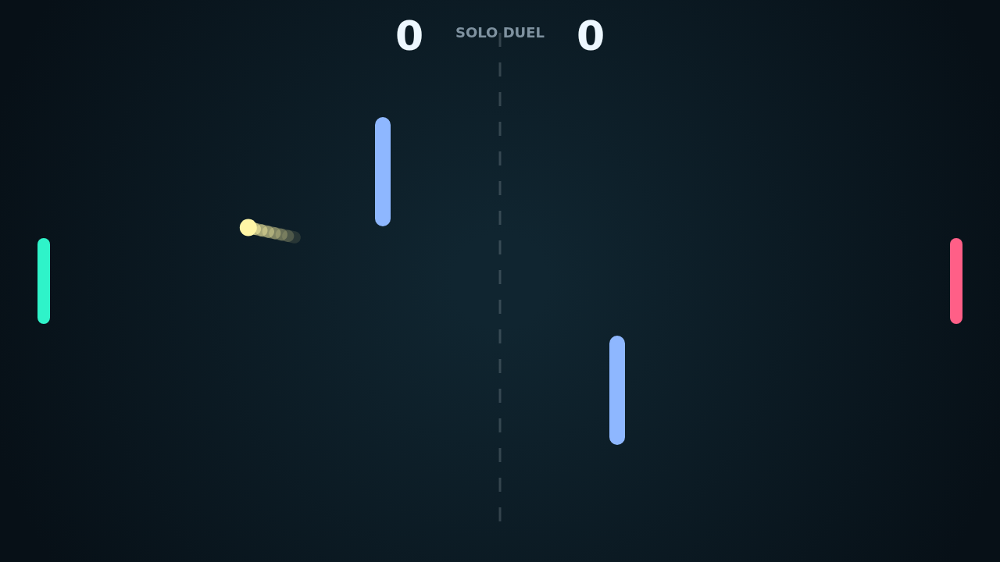

# Carom

Carom is a fast top-down paddle duel where every return can change the shape of
the rally. The ball ricochets between two bright paddles, the top and bottom
walls, and a pair of fixed center obstacles that turn open space into a bank-shot
puzzle.

The heart of a match is spin. Move a paddle as it strikes and the ball bends
after contact, letting a simple block become a curving shot that slides around an
obstacle or kicks into a sharper angle.

Solo mode gives you the left paddle against a reactive right-side opponent.
Versus mode puts both paddles on the same keyboard for quick local matches.

Points are clean and tense: first to 11 wins, but only with a two-point lead, so
a close game keeps building until one side finally breaks the rally open.
